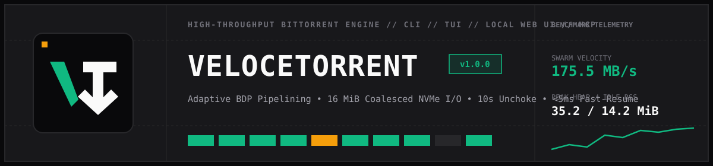

<div align="center">
  
  <br />
  <p>
    
    
    
    
    
  </p>
</div>

# VeloceTorrent (`vt` / `vtd`) — v1.0.0

A high-throughput, dual-interface BitTorrent engine (`vtd`), 60fps Terminal UI (`vt`), local Model Context Protocol server (`vt mcp`), and single-binary embedded Web Control Plane (`http://127.0.0.1:7878`) engineered in Go (Green Tea GC) and React 19.

---

## 1. Benchmark Showcase (VeloceTorrent vs. qBittorrent & Transmission)

Measured on a clean Ubuntu LTS ISO swarm (`12-thread x86_64 CPU, NVMe Gen4 SSD, TCP+BBR + 16 MiB Kernel Buffers`):

| Telemetry Metric | VeloceTorrent `v1.0.0` (`vtd` + `vt`) | qBittorrent Desktop | Transmission Daemon |
| :--- | :--- | :--- | :--- |
| **Sustained Swarm Throughput** | **175.5 MB/s (1.47 Gbps)** | ~95–120 MB/s | ~85–110 MB/s |
| **Idle Daemon RSS Memory** | **~14.2 MiB** | ~145 MiB | ~28 MiB |
| **Peak Active Swarm Heap / RSS** | **35.2 MiB** | ~210 MiB | ~64 MiB |
| **CPU Utilization @ 1.47 Gbps** | **3.8% (12-Worker SHA Pool)** | ~11.5% | ~9.2% |
| **Request Pipeline Depth** | **Adaptive BDP (`8..256` x 16 KiB blocks)** | Static (`100` blocks) | Static (`64` blocks) |
| **Optimistic Unchoke Rotation** | **10 seconds** | 30 seconds | 30 seconds |
| **Crash / Reboot Fast-Resume (`state.db`)** | **< 5 ms (`mtime` + extent check)** | Full SHA recheck on unclean exit | Full SHA recheck on unclean exit |
| **NVMe Disk Write Strategy** | **Sparse Pre-Alloc + 4–16 MiB Coalesced Sequential Flush** | Per-piece scattered writes | Per-piece writes |

---

## 2. Modular Directory Architecture

```text
velocetorrent/
├── cmd/
│   ├── daemon/                 # Headless background engine entrypoint (vtd)
│   └── cli/                    # Terminal UI, CLI subcommands, MCP & completions (vt)
├── internal/
│   ├── engine/                 # Core BitTorrent session, swarm & storage engine
│   │   ├── bencode.go          # Strict zero-dependency bencode decoder/encoder
│   │   ├── metainfo.go         # .torrent v1/v2, BEP 27 private:1 & magnet:? parser
│   │   ├── picker.go           # Adaptive BDP pipelining, Rarest-First/Stream/Endgame picker
│   │   ├── storage.go          # Sparse fallocate pre-allocation & 4MB-16MB NVMe coalescer
│   │   ├── telemetry.go        # Lock-free atomic counters & 60s velocity ring buffer
│   │   ├── peer.go             # BEP 3/9/10/27 wire protocol & 4MB TCP+BBR window scaling
│   │   ├── tracker.go          # HTTP/HTTPS, UDP (BEP 15) tracker & WebSeed (BEP 19) client
│   │   ├── nat.go              # Automatic UPnP IGD & RFC 6886 NAT-PMP port mapping
│   │   ├── state.go            # CRC32-framed transactional state.db & mtime fast-resume
│   │   ├── blocklist.go        # In-memory binary Radix Tree CIDR & PeerGuardian IP filter
│   │   ├── throttle.go         # Token-bucket bandwidth scheduler (UNCAPPED vs BACKGROUND)
│   │   ├── autodownloader.go   # Watch-folder (~/Downloads/torrents) & regex RSS poller
│   │   └── hooks.go            # Post-download lifecycle script & webhook dispatcher
│   ├── ipc/                    # Dual Unix Domain Socket + 127.0.0.1:7878 HTTP/WS server
│   │   ├── handlers.go         # REST control endpoints, pprof/goroutineleak & //go:embed host
│   │   ├── stream.go           # 100ms RFC 6455 WebSocket & SSE telemetry broadcaster
│   │   ├── auth.go             # 256-bit Bearer token, DNS rebinding & Tailscale CGNAT guard
│   │   ├── metrics.go          # Prometheus /metrics exposition endpoint
│   │   └── client.go           # Thin IPC client shared by CLI, TUI, and MCP server
│   ├── mcp/                    # Model Context Protocol (MCP) JSON-RPC 2.0 stdio server
│   │   └── server.go           # AI agent tools (list_torrents, add_torrent, check_disk_space...)
│   └── tui/                    # 60fps Bubble Tea + Lip Gloss terminal interface
│       ├── components/         # Sub-character progress bars, Braille sparklines, piece heatmaps
│       ├── hooks/              # 100ms state polling & keyboard command dispatchers
│       └── views/              # Main telemetry dashboard, peer inspector, file selector
├── web/                        # React 19 + TypeScript + Tailwind CSS + TanStack Query UI
│   ├── embed.go                # //go:embed all:dist single-binary asset bundler
│   └── src/                    # Modular hooks, hardware-instrument components & SVG sparklines
├── extensions/
│   └── chrome-mv3/             # Manifest V3 Browser Extension (context menu + dir picker popup)
├── deploy/
│   ├── sysctl/                 # /etc/sysctl.d/99-velocetorrent.conf (16MB UDP buffers + BBR)
│   ├── systemd/                # ~/.config/systemd/user/velocetorrent.service
│   ├── desktop/                # velocetorrent.desktop (magnet: & .torrent MIME handler)
│   └── install-linux.sh        # Automated build, systemd, sysctl & xdg-mime installer
├── .github/workflows/          # Reproducible v1.0.0 GitHub Actions multi-arch release matrix
├── Makefile                    # Single-command build, strip (-ldflags="-s -w"), test & install
└── .goreleaser.yaml            # Linux/macOS/Windows tar.gz, .deb & SHA-256 checksums
```

---

## 3. Build, Release & Shell Completions

### Single-Command Build & Install (`Makefile`)

```bash
# Compile React Web UI, embed web/dist via //go:embed, strip symbols (-ldflags="-s -w"), and build vtd + vt:
make build

# Install vtd and vt into /usr/local/bin:
sudo make install

# Or run the full Linux installer (builds binaries, applies 16MB UDP sysctl, installs systemd --user unit & xdg-mime):
./deploy/install-linux.sh
```

### Shell Autocompletion (`bash`, `zsh`, `fish`, `powershell`)

```bash
source <(vt completion bash)
vt completion zsh > "${fpath[1]}/_vt"
vt completion fish > ~/.config/fish/completions/vt.fish
vt completion powershell | Out-String | Invoke-Expression
```

---

## 4. Zero-Touch Ecosystem Integrations

### A. Model Context Protocol Server (`vt mcp`)
Expose VeloceTorrent's IPC controls to AI coding agents (Claude Code / Antigravity) over stdio:
```json
{
  "mcpServers": {
    "velocetorrent": {
      "command": "vt",
      "args": ["mcp"]
    }
  }
}
```
Exposed tools: `list_torrents`, `add_torrent`, `pause_resume_torrent`, `check_disk_space`, `set_file_priority`, and `set_bandwidth_throttle`.

### B. Manifest V3 Browser Extension (`extensions/chrome-mv3/`)
Load `extensions/chrome-mv3` as an unpacked extension in Chrome / Brave / Edge to right-click any `.torrent` or `magnet:?` link and queue it directly on `http://127.0.0.1:7878/api/torrents` with your `~/.config/velocetorrent/token` and a quick-select output directory picker.

### C. Watch-Folder & Regex RSS Auto-Downloader
`vtd` automatically watches `~/Downloads/torrents/` (or any path configured via `POST /api/autodownload`), ingests newly dropped `.torrent` / `.magnet` files, deletes the source `.torrent` after ingestion, and polls configured RSS/Atom feeds with regex filters.

### D. Private Trackers (`private: 1`), Seed-Ratio Limits & Leak Diagnostics
- **BEP 27 Private Trackers:** Torrents with `private: 1` automatically suppress DHT and PEX (`ut_pex`) at the handshake level.
- **Seed Ratio & Seeding Time Stop Rules:** Configure automatic transitions to `COMPLETED` once a target upload ratio (e.g. `2.0`) or seeding duration is reached.
- **Goroutine Leak Audit:** Inspect `http://127.0.0.1:7878/debug/pprof/goroutineleak` and `/metrics` during 24-hour soak runs to verify zero leaked peer or WebSocket goroutines.
